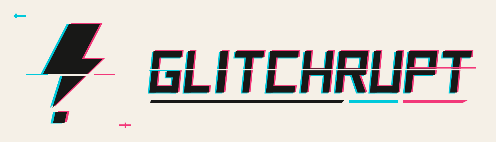
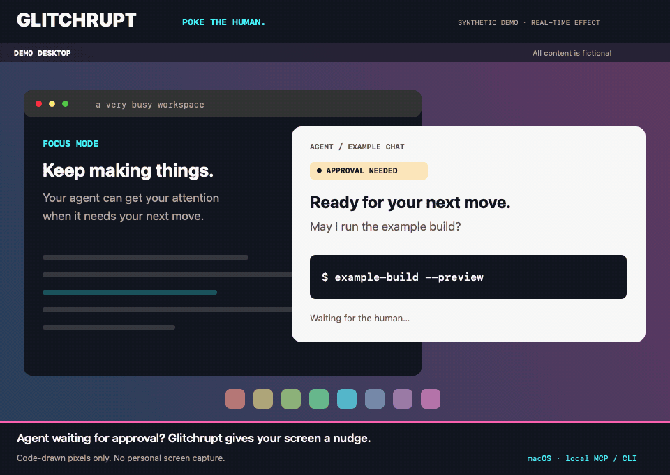

<p align="center"></p>

# Glitchrupt

**Your agent needs you. Give the screen a little attitude.**

Twelve windows deep? Agent waiting on a question? Glitchrupt gives your desktop a **600-millisecond jolt**: fractured pixels, a crack of digital static, then back to your business. The whole animation runs faster; every beat stays in.

It works over your other apps, even with Codex in the background. Everything runs on your Mac. Desktop images stay in memory and disappear after the effect; nothing is saved or sent away.

## See the jolt



**Entirely synthetic demo.** No real desktop, chats, files, or screen recordings. It uses the app’s renderer at real speed: **600 ms → 200 ms gap → 600 ms**. [Watch with original sound](assets/demo/demo.mp4), or [see a still](assets/demo/poster.png). Reminders repeat every 15 minutes while registered and stop when the agent clears the wait after your reply or unblock.

[How the demo is made](docs/demo.md).

## Pick your noise

Five original crackles: **Classic, Fracture, Brownout, Arc, Stutter**. Open the desktop tester and hit **Compare all five**. Windowed previews work without screen capture.

You stay in charge: switch sound off, pause agent cues from the menu bar, or quit. Agent requests share a five-second cooldown. Reduce Motion suppresses desktop effects.

## Kick it off

You need macOS 14+, Xcode Command Line Tools with Swift, Python 3.11+, and [uv](https://docs.astral.sh/uv/).

```sh
./scripts/build.sh
open build/Glitchrupt.app
uv sync --locked
uv run --locked glitchrupt preview --variant classic
```

For the whole desktop, enable **Glitchrupt** in macOS **Privacy & Security → Screen & System Audio Recording**, then relaunch if asked. The app briefly covers each display with a distorted snapshot and removes the overlays when it finishes.

```sh
uv run --locked glitchrupt signal --variant fracture
```

## Give your agent the signal

Glitchrupt ships a CLI and a local **MCP server**. Agents can check status, list sounds, play a cue, register an approval wait, inspect pending waits, and resolve them.

```sh
uv run --locked glitchrupt status
uv run --locked glitchrupt mcp
```

[Connect it to Codex](docs/codex-integration.md), or use the [other-agent setup and tool reference](docs/agent-usage.md). MCP registration is a separate setup step. For an approval wait, Glitchrupt plays **600 ms → 200 ms gap → 600 ms**, then repeats every **15 minutes** until the agent resolves it. Duplicate registrations do not replay the cue.

The optional Codex hook handles the initial double cue. Automatic repeats require an explicit wait/resolve workflow because the available desktop hook events cannot reliably confirm when an approval was answered. [Approval setup and limits](docs/approval-alerts.md).

## Make it yours

[MIT licensed](LICENSE). Editable artwork, sound generators, Swift app, and Python tools live together. The visuals and sounds are original; this independent project has no affiliation with Marvel or Sony.

```sh
uv run --locked python -m pytest -q
./scripts/package.sh
```

Packaging creates local source/app ZIPs and checksums. The current app is signed for local testing; [public releases need signing and notarization](docs/releasing.md). See [architecture](docs/architecture.md), [brand sources](docs/brand.md), and [verification](docs/validation.md) for the nuts and bolts.

**Poke the human. Carry on.**
